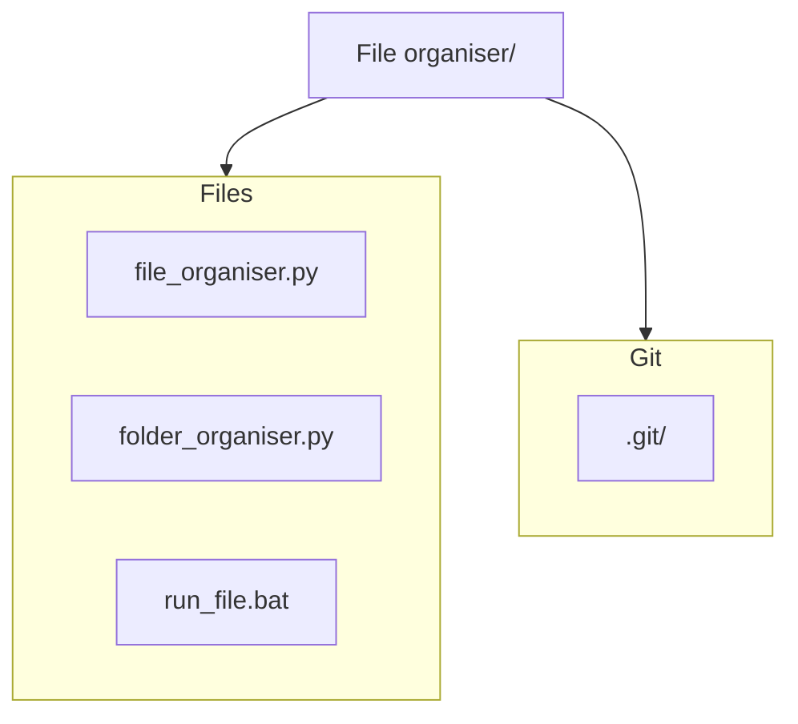

# 📂 File Organiser


A lightweight utility to automatically organise your **Downloads** folder (or any target directory) by moving files into categorized sub‑folders. Two complementary scripts are provided:

- **`file_organiser.py`** – Simple, non‑interactive sorter that moves each file based on a predefined mapping.
- **`folder_organiser.py`** – Interactive, recursive sorter that scans sub‑folders, prompts for confirmation, and removes empty directories.

The repository also includes a convenience **`run_file.bat`** to execute the preferred script on Windows.

---

## ✨ Features

- **Category‑based sorting** – Images, Documents, Videos, Audio, Archives, Python, Executables, Programming, etc.
- **Duplicate handling** – Automatically appends an incrementing suffix (`file_1.txt`, `file_2.txt`) when a target name already exists.
- **Recursive scan** – `folder_organiser.py` can walk through nested sub‑folders and clean up empty directories.
- **Safety prompts** – Prevent accidental moves by confirming before bulk operations.
- **Cross‑platform** – Pure Python (standard library only) – works on Windows, macOS, Linux.

---

## 📦 Installation

1. **Clone the repository**
   ```bash
   git clone <repository‑url>
   cd "File organiser"
   ```
   ```
3. **Install dependencies** – there are none beyond the Python standard library.

---

## 🚀 Usage

### 1️⃣ `file_organiser.py`
A quick‑fire sorter that runs unattended.
```bash
python file_organiser.py
```
The script scans `~/Downloads`, determines the appropriate folder for each file, creates the folder if necessary, and moves the file.

### 2️⃣ `folder_organiser.py`
A more robust, interactive version.
```bash
python folder_organiser.py
```
- Scans the Downloads directory **recursively**.
- Lists found files and their target categories.
- Prompts you to type **YES** before any moves are performed.
- Cleans up empty folders afterwards.

### 3️⃣ `run_file.bat`
Double‑click this batch file to launch `folder_organiser.py` with a single action (Windows only).

---

## 📂 Project Structure



---

## 🤝 Contributing

Contributions are welcome! Feel free to open an **issue** or submit a **pull request**.

1. Fork the repo.
2. Create a feature branch (`git checkout -b feature/awesome‑feature`).
3. Commit your changes and push.
4. Open a pull request.

---


## 🙋‍♂️ Author

**Parasu Raman** 
